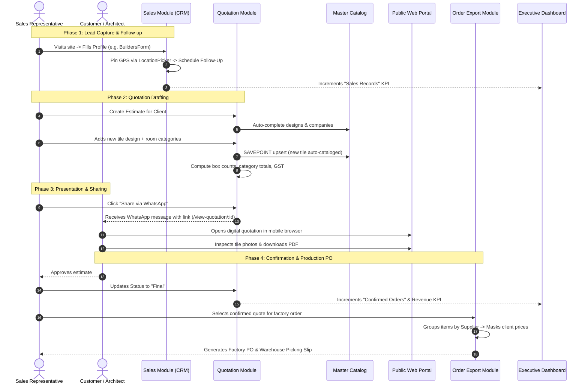

# 📘 Omada Sales Suite — Comprehensive Project Documentation & Architecture Guide

Welcome to the **Omada Sales Suite** developer and workflow documentation. This document serves as the authoritative, deep-dive technical reference for engineers, technical leads, and product contributors. It covers the overall system architecture, component hierarchies, department profile structures, detailed internal mechanics of each module, cross-module data pipelines, database models, and operational runbooks.

---

## 📑 Table of Contents
1. [System Architecture & Technology Stack](#1-system-architecture--technology-stack)
2. [Project Repository & File Structure](#2-project-repository--file-structure)
3. [Authentication, Authorization & RBAC](#3-authentication-authorization--rbac)
4. [Department Profile Files & Lead Management (CRM)](#4-department-profile-files--lead-management-crm)
   - [4.1 Profile Architecture & Polymorphic Data Model](#41-profile-architecture--polymorphic-data-model)
   - [4.2 Builders & Developers Profile (`BuildersForm.tsx`)](#42-builders--developers-profile-buildersformtsx)
   - [4.3 Architects & Interior Designers Profile (`ArchitectsForm.tsx`)](#43-architects--interior-designers-profile-architectsformtsx)
   - [4.4 Contractors Profile (`ContractorsForm.tsx`)](#44-contractors-profile-contractorsformtsx)
   - [4.5 End-to-End / Turnkey Profile (`EndToEndForm.tsx`)](#45-end-to-end--turnkey-profile-endtoendformtsx)
   - [4.6 Profile Auxiliaries: Follow-Up Manager & Geolocation Picker](#46-profile-auxiliaries-follow-up-manager--geolocation-picker)
   - [4.7 Follow-Up Notification Engine](#47-follow-up-notification-engine)
5. [Core Modules: Deep Dive & Mechanics](#5-core-modules-deep-dive--mechanics)
   - [5.1 Quotation Management Module](#51-quotation-management-module)
   - [5.2 Public Quotation View & Client Sharing (`PublicQuotationViewPage.tsx`)](#52-public-quotation-view--client-sharing-publicquotationviewpagetsx)
   - [5.3 Sample Management Module](#53-sample-management-module)
   - [5.4 Order Export & Factory PO Generation](#54-order-export--factory-po-generation)
   - [5.5 Master Data Catalog (Products & Companies)](#55-master-data-catalog-products--companies)
   - [5.6 Executive Analytics Dashboard](#56-executive-analytics-dashboard)
   - [5.7 User & Team Administration](#57-user--team-administration)
6. [End-to-End Cross-Module Data Flow](#6-end-to-end-cross-module-data-flow)
7. [Database Schema, Sequences & Indexes](#7-database-schema-sequences--indexes)
8. [Comprehensive API Route Specifications](#8-comprehensive-api-route-specifications)
9. [Setup, Migrations, Environment & Operations](#9-setup-migrations-environment--operations)

---

## 1. System Architecture & Technology Stack

Omada Sales Suite is built as a decoupled, multi-tiered enterprise application designed for tile, stone, and interior manufacturing and distribution businesses.

```
┌─────────────────────────────────────────────────────────────────────────┐
│                       CLIENT TIER (React 18 + Vite)                     │
│  - Single Page Application (SPA) bundled via Vite                       │
│  - UI: Tailwind CSS, Radix UI Primitives, Lucide Icons                  │
│  - State & Network: TanStack React Query, Custom React Contexts         │
│  - Document Engines: jsPDF + autoTable, html2canvas (Image/PDF Render)  │
│  - Geolocation & Maps: Leaflet, Google Maps URL resolver                │
│  - Public Portal: Tokenless client view route (/view-quotation/:id)     │
└────────────────────────────────────┬────────────────────────────────────┘
                                     │
                                     │ HTTPS / REST (JSON + Bearer JWT)
                                     ▼
┌─────────────────────────────────────────────────────────────────────────┐
│                     APPLICATION TIER (Node.js + Express)                │
│  - Express 5 REST API with TypeScript                                   │
│  - Security: JWT Authentication, Role-Based Access Control (RBAC)       │
│  - High-Volume Request Parsing: 200MB JSON/URL-encoded payload support  │
│  - Normalization Engine: Auto-uppercase casing and space trimming       │
│  - Catalog Synchronization: Concurrent-safe Postgres SAVEPOINT engine   │
│  - Multi-Origin CORS Management: Configurable origin whitelists         │
└────────────────────────────────────┬────────────────────────────────────┘
                                     │
                                     │ SQL Queries / Managed Connection Pool
                                     ▼
┌─────────────────────────────────────────────────────────────────────────┐
│                        DATA TIER (PostgreSQL 14+)                       │
│  - ACID Transactions for Quotation, Category & Item cascading           │
│  - Sequences: quotation_number_seq, sample_number_seq, order_number_seq │
│  - Polymorphic Sales Storage: Single-table inheritance via `dept`       │
│  - Case-Insensitive B-Tree Indexes for fast filtering & search          │
│  - Foreign Key Constraints with ON DELETE CASCADE / ON DELETE SET NULL  │
└─────────────────────────────────────────────────────────────────────────┘
```

### Technology Matrix

| Layer | Technology | Primary Purpose |
|---|---|---|
| **Frontend Framework** | React 18, TypeScript, Vite | High-performance SPA with client-side routing |
| **Styling & Components** | Tailwind CSS, Radix UI / Shadcn | Responsive layouts, accessible dialogs, selects, toasts |
| **Data Fetching** | Fetch API wrapper (`api.ts`), TanStack Query | Token injection, 401 handling, optimistic updates |
| **Export Engines** | jsPDF, jspdf-autotable, html2canvas | High-fidelity branded quotation, sample, and PO exports |
| **Backend Runtime** | Node.js (v18+), Express 5, TypeScript | Scalable REST API with strict typing |
| **Database Connector** | `pg` (node-postgres) | Connection pooling (`PoolClient`) with transaction support |
| **Authentication** | JSON Web Tokens (`jsonwebtoken`), `bcryptjs` | Stateless session management, password hashing |
| **Relational Database**| PostgreSQL 14+ | Relational data persistence with custom sequences |

---

## 2. Project Repository & File Structure

The project is structured as a monorepo containing distinct `backend` and `frontend` packages:

```
omada/
├── backend/
│   ├── db/
│   │   ├── schema.sql                   # Base DDL definitions for tables and relations
│   │   ├── sequence_and_pagination.sql  # Sequences for quote/sample/order IDs & indexes
│   │   ├── production_optimizations.sql # Composite query performance & B-tree indexes
│   │   └── seed.sql                     # Reference data & initial seeds
│   ├── src/
│   │   ├── controllers/
│   │   │   ├── auth.controller.ts       # Login, register, me, user CRUD & password verify
│   │   │   ├── master.controller.ts     # Master products & companies CRUD + dynamic usage
│   │   │   ├── quotations.controller.ts # Quotation/Sample CRUD, items, status & public view
│   │   │   ├── sales.controller.ts      # Department sales leads, follow-ups & filters
│   │   │   └── index.ts                 # Controller aggregator export
│   │   ├── middleware/
│   │   │   └── auth.ts                  # JWT token verification (auth) & admin check (adminAuth)
│   │   ├── routes/
│   │   │   ├── auth.routes.ts           # Authentication & user administration routes
│   │   │   ├── dashboard.routes.ts      # Aggregated metric endpoints
│   │   │   ├── master.routes.ts         # Catalog endpoints for companies and products
│   │   │   ├── quotations.routes.ts     # Commercial & sample quotation routes + public view
│   │   │   └── sales.routes.ts          # CRM sales lead endpoints
│   │   ├── db.ts                        # Centralized PostgreSQL pg.Pool instance
│   │   ├── index.ts                     # Express server bootstrap, CORS, DDL sync, start
│   │   └── utils.ts                     # syncProductToMaster, casing mappers, row helpers
│   ├── migrate.cjs                      # Incremental database migration runner
│   ├── seed.cjs                         # Default admin initialization script
│   ├── .env                             # Environment variables (port, db credentials, jwt)
│   └── package.json
├── frontend/
│   ├── src/
│   │   ├── assets/
│   │   │   └── omada-logo.png           # High-resolution official company logo
│   │   ├── components/
│   │   │   ├── sales/                   # Department Lead Profile Forms & CRM Subcomponents
│   │   │   │   ├── BuildersForm.tsx     # Builder / Developer lead profile form
│   │   │   │   ├── ArchitectsForm.tsx   # Architect & Interior Designer lead profile form
│   │   │   │   ├── ContractorsForm.tsx  # Contractor lead profile form
│   │   │   │   ├── EndToEndForm.tsx     # Turnkey / End-to-End client lead profile form
│   │   │   │   ├── FollowUpManager.tsx  # Timestamped interaction history & reminder scheduler
│   │   │   │   └── LocationPicker.tsx   # GPS coordinate capture & Google Maps bridge
│   │   │   ├── ui/                      # Reusable UI primitives (Dialog, Select, Table, Sonner, etc.)
│   │   │   ├── AppLayout.tsx            # Main layout wrapper with sidebar, department switcher, header
│   │   │   ├── CustomPagination.tsx     # Reusable server-side pagination bar
│   │   │   └── NavLink.tsx              # Active state navigation links
│   │   ├── contexts/
│   │   │   └── AuthContext.tsx          # JWT session, active user, department state & logout
│   │   ├── hooks/
│   │   │   ├── useDebounce.ts           # Debounce utility hook for instant search queries
│   │   │   ├── useFollowUpNotifications.tsx # Proactive follow-up reminder alerts hook
│   │   │   └── use-toast.ts             # Toast notification triggering hook
│   │   ├── lib/
│   │   │   ├── api.ts                   # Axios-like fetch wrapper with Bearer token injection
│   │   │   └── utils.ts                 # Global search, classnames merger, date formatters
│   │   ├── pages/
│   │   │   ├── LoginPage.tsx            # Login screen with authentication guard
│   │   │   ├── DashboardPage.tsx        # High-level executive KPI indicators & activity feeds
│   │   │   ├── DepartmentSelectionPage.tsx # Department switcher screen for sales staff
│   │   │   ├── SalesPage.tsx            # Department CRM grid, search, modals & lead manager
│   │   │   ├── QuotationPage.tsx        # Multi-category price estimator, PDF generator, WhatsApp share
│   │   │   ├── PublicQuotationViewPage.tsx # Public web view for customers with instant PDF export
│   │   │   ├── SampleManagementPage.tsx # Sample slips creation, box tracking & dispatch slips
│   │   │   ├── OrderExportPage.tsx      # Factory/Supplier PO grouper & warehouse dispatch sheets
│   │   │   ├── MasterDataPage.tsx       # Product and Company master catalog maintenance
│   │   │   └── UserManagementPage.tsx   # Admin user directory, role assignment & credential inspection
│   │   ├── App.tsx                      # Route registration, Suspense fallbacks & auth guards
│   │   └── main.tsx                     # React DOM root entry point
│   └── package.json
└── PROJECT_DOCUMENTATION.md             # This document
```

---

## 3. Authentication, Authorization & RBAC

The application enforces a hybrid Authentication and Role-Based Access Control (RBAC) model.

### 3.1 User Roles & Scope Matrix

| Role | System Scope | Sales Department Isolation | User Management | Plaintext Password Access |
|---|---|---|---|---|
| **`Admin`** | Global Access across all departments | Can view all data or filter by any individual salesperson | Full (Create, Update, Delete) | Yes (Authorized via password verification) |
| **`User`** / Sales Rep | Restricted to assigned department (`selected_department`) | Strict tenancy: Queries filter by `created_by = user.id` | None | No |

### 3.2 Authentication Flow

```
[ Frontend: LoginPage ] 
         │ 1. POST /api/auth/login { email, password }
         ▼
[ Backend: auth.controller.ts ]
         │ 2. Query user by email from `users` table
         │ 3. bcrypt.compare(password, user.password)
         │ 4. Generate JWT containing: { id, email, role, selectedDepartment }
         ▼
[ Frontend: AuthContext ]
         │ 5. Stores `omada_token` and `omada_user` in localStorage
         │ 6. Updates AuthContext state (`user`, `isAuthenticated`)
         ▼
[ Authenticated Requests ]
         │ 7. `api.ts` attaches `Authorization: Bearer <token>` to headers
         │ 8. Backend `auth` middleware verifies token & injects `req.user`
```

### 3.3 Security Implementation Details
- **Token Verification (`backend/src/middleware/auth.ts`)**: Decodes the JWT token. If expired or forged, immediately halts execution with `401 Unauthorized`.
- **Admin Guard (`adminAuth`)**: Validates `req.user.role === 'Admin'`. If not, returns `403 Forbidden`.
- **Database Tenancy Guard**: In both `sales.controller.ts` and `quotations.controller.ts`, when `req.user.role !== 'Admin'`, the SQL query forcibly appends `WHERE created_by = $userId`. This guarantees non-admin sales reps cannot view or tamper with other representatives' leads or quotations.
- **Admin Credential Verification**: Admin users can inspect team credentials in the User Management console after confirming administrative rights via `POST /api/auth/users/:id/verify-password`.

---

## 4. Department Profile Files & Lead Management (CRM)

Lead tracking in the Omada Sales Suite is partitioned into 4 distinct sales departments. Because each client vertical has unique stakeholder hierarchies (e.g., a builder has PMCs and site supervisors, while an architect studio has principal designers and purchase managers), the system uses specialized **Department Profile Form components**.

### 4.1 Profile Architecture & Polymorphic Data Model

All 4 profiles persist into a single unified database table: `sales_records`.
- The column `dept` acts as the discriminator (`'builders'`, `'architects'`, `'contractors'`, `'end-to-end'`).
- The single-table inheritance pattern eliminates complex SQL JOINs while providing dynamic column reuse.
- All party names, company titles, and locations are normalized to uppercase on write to facilitate accurate indexing and duplicate elimination.

```
┌─────────────────────────────────────────────────────────────────────────┐
│                           SalesPage.tsx                                 │
│  - Reads `activeDept` state (or user.selectedDepartment)                │
│  - Renders Department Switcher Tabs (Builders, Architects, etc.)        │
│  - Hosts Unified Lead Modal (Create / Edit / View Only)                 │
└────────────────────────────────────┬────────────────────────────────────┘
                                     │ Dynamic Component Injection
            ┌────────────────────────┼────────────────────────┐
            ▼                        ▼                        ▼
  [ BuildersForm.tsx ]     [ ArchitectsForm.tsx ]   [ ContractorsForm.tsx ]
            │                        │                        │
            └────────────────────────┼────────────────────────┘
                                     ▼
                           [ EndToEndForm.tsx ]
                                     │
           Embedded Subcomponents In Every Profile Form:
           ├── LocationPicker.tsx    (Leaflet Map / Lat & Lng Geocoding)
           └── FollowUpManager.tsx   (Timestamped CRM Conversation Log)
```

---

### 4.2 Builders & Developers Profile (`BuildersForm.tsx`)

- **Target Persona**: Large-scale commercial & residential construction projects, real estate developers, and infrastructure firms.
- **Source Component**: `frontend/src/components/sales/BuildersForm.tsx`
- **Fields Captured**:
  1. **Primary Project**: `siteName` (Name of project/site), `location` (City/Area, e.g. "Vadodara, Mumbai").
  2. **Authorized Decision Maker**: `authorizedPersonName`, `contactNumber`.
  3. **Site Execution Team**: `supervisorName` (Site Supervisor), `supervisorContact`.
  4. **Project Management Consultant**: `pmcName` (PMC Company Name), `pmcContact`.
  5. **Design Consultants**:
     - `architectCompany`, `architectName`, `architectContact`.
     - `interiorCompany`, `interiorDesignerName`, `interiorDesignerContact`.
     - `structuralEngineerCompany`, `structuralEngineerName`, `structuralEngineerContact`.
  6. **Site Location**: `LocationPicker` (Address string, Latitude, Longitude, and Google Maps direct link).
  7. **Notes & CRM Timeline**: General site observations and `FollowUpManager`.

---

### 4.3 Architects & Interior Designers Profile (`ArchitectsForm.tsx`)

- **Target Persona**: Architectural design studios, interior design practices, and independent consultants.
- **Source Component**: `frontend/src/components/sales/ArchitectsForm.tsx`
- **Fields Captured**:
  1. **Studio Identity**: `architectCompany` (Design Practice / Firm Name), `firmName` (Studio or Individual Name), `location` (Area/City).
  2. **Primary Contacts**: `authorizedPersonName` (Senior Partner / Principal), `contactNumber`.
  3. **Procurement Personnel**: `purchasePersonName` (Purchase / Material Sourcing Manager), `purchasePersonContact`.
  4. **Collaborators**:
     - `interiorCompany`, `interiorDesignerName`, `interiorDesignerContact`.
     - `structuralEngineerCompany`, `structuralEngineerName`, `structuralEngineerContact`.
  5. **Studio Location**: `LocationPicker` with coordinate pinning.
  6. **Description / Notes**: Design preferences, ongoing projects list, and `FollowUpManager`.

---

### 4.4 Contractors Profile (`ContractorsForm.tsx`)

- **Target Persona**: Civil contractors, tiling contractors, masonry firms, and execution partners.
- **Source Component**: `frontend/src/components/sales/ContractorsForm.tsx`
- **Fields Captured**:
  1. **Contractor Identity**: `contractorOwnerName` (Contractor or Firm Owner), `location`, `contractorOwnerContact`.
  2. **End-Client Information**: `customerName` (Property owner hiring the contractor), `customerContact`.
  3. **Associated Design Consultants**:
     - `architectCompany`, `architectName`, `architectContact`.
     - `interiorCompany`, `interiorDesignerName`, `interiorDesignerContact`.
     - `structuralEngineerCompany`, `structuralEngineerName`, `structuralEngineerContact`.
  4. **Site Coordinates**: `LocationPicker` for site address and map pins.
  5. **CRM Interactions**: Material requirements notes and `FollowUpManager`.

---

### 4.5 End-to-End / Turnkey Profile (`EndToEndForm.tsx`)

- **Target Persona**: Direct residential bungalow owners, retail turnkey clients, and private villa projects.
- **Source Component**: `frontend/src/components/sales/EndToEndForm.tsx`
- **Fields Captured**:
  1. **Client Identity**: `customerName` (Direct Client), `location` (Area/City), `contactNumber`.
  2. **Alternate Contact / Reference**: `anotherName` (Family member, project manager, or reference person), `anotherContact`.
  3. **Assigned Sales Representative**: `salesmanName` (Internal sales executive servicing this turnkey account).
  4. **Delivery Address**: Complete physical delivery address string.
  5. **Description / Notes**: Tile specifications, budget range, and `FollowUpManager`.

---

### 4.6 Profile Auxiliaries: Follow-Up Manager & Geolocation Picker

#### `FollowUpManager.tsx`
- Embedded at the base of every profile form.
- Manages an array of interactions `{ id, date, notes, createdAt }`.
- Allows sales staff to schedule future touchpoints (call back dates, material sample delivery schedules).
- When a lead is saved, all new follow-ups are written to the `follow_ups` table linked via foreign key `sales_record_id`.

#### `LocationPicker.tsx`
- Embeds interactive mapping and reverse geocoding via Leaflet / OpenStreetMap.
- Captures exact `lat` and `lng` floating-point coordinates.
- Displays an "Open in Google Maps" shortcut button in the table view (`https://maps.google.com/?q=${lat},${lng}`) so reps can navigate directly to the job site.

---

### 4.7 Follow-Up Notification Engine

- **Source Hook**: `frontend/src/hooks/useFollowUpNotifications.tsx`
- **Functionality**:
  1. Periodically queries active leads across departments.
  2. Evaluates the most recent follow-up date for each lead against `new Date()`.
  3. Classifies leads into **Overdue Follow-ups** (date < today) and **Today's Follow-ups** (date === today).
  4. Renders badge counts on the navigation sidebar and sales table headers.
  5. Fires visual Sonner/Toast alerts notifying sales executives of pending calls.

---

## 5. Core Modules: Deep Dive & Mechanics

### 5.1 Quotation Management Module

- **Source Files**: `frontend/src/pages/QuotationPage.tsx`, `backend/src/controllers/quotations.controller.ts`
- **Business Purpose**: Multi-category estimate builder that generates commercial quotes, computes box requirements, syncs items to the product master, and exports branded PDFs and images.

#### Data Hierarchy & Relational Schema:
```
Quotation Header (quotations)
  ├── ID: Q-1001 (generated via custom PostgreSQL sequence)
  ├── Customer Details: customer_name, company_name, mobile, site_address, reference_info
  ├── Commercial Terms: include_gst (BOOLEAN), extra_terms (TEXT), status ('Pending' | 'Final')
  └── 1 : N Categories (quotation_categories)
        ├── Name: "MASTER BEDROOM TILES", "OUTDOOR CLADDING"
        └── 1 : N Items (quotation_items)
              ├── Product Specs: company, design, finish, size, weight, image
              └── Math Specs: multiplier (default 16), qty, unit_price, total, boxes
```

#### Calculation & Precision Engine:
1. **Item Total**:
   $$\text{Total} = \text{Quantity} \times \text{Unit Price}$$
2. **Box Requirement**:
   $$\text{Boxes} = \frac{\text{Quantity}}{\text{Multiplier}}$$
3. **Category Total**:
   $$\text{Category Total} = \sum \text{Item Totals within that Category}$$
4. **Payable Grand Total**:
   $$\text{Subtotal} = \sum \text{Category Totals}$$
   $$\text{Grand Total} = \begin{cases} \text{Subtotal} \times 1.18 & \text{if } \text{include\_gst} = \text{true} \\ \text{Subtotal} & \text{if } \text{include\_gst} = \text{false} \end{cases}$$

#### Catalog Auto-Sync Engine (`syncProductToMaster`):
When a quotation is saved via `POST /api/quotations` or updated via `PUT /api/quotations/:id`, the backend executes:
```typescript
// backend/src/utils.ts
await client.query('SAVEPOINT master_product_sync');
try {
    await client.query(`
        INSERT INTO master_products (company, design, finish, size, weight, image)
        VALUES ($1, $2, $3, $4, $5, $6)
    `, [company, design, finish, size, weight, image]);
    await client.query('RELEASE SAVEPOINT master_product_sync');
} catch (err) {
    if (err.code === '23505') { // Postgres duplicate key error
        await client.query('ROLLBACK TO SAVEPOINT master_product_sync');
    }
}
```
*Why this matters*: Sales representatives can enter arbitrary tile designs directly while on client meetings. The backend automatically catalogs them without crashing or throwing unique constraint errors if another representative added the same design concurrently.

---

### 5.2 Public Quotation View & Client Sharing (`PublicQuotationViewPage.tsx`)

- **Frontend Route**: `/view-quotation/:id`
- **Backend Endpoint**: `GET /api/quotations/public/:id` (Public, no auth header required)
- **Business Purpose**: Enables sales staff to share a live, mobile-friendly digital quotation with clients via WhatsApp or email.

#### Mechanics:
1. **Tokenless Public Access**: The endpoint `/api/quotations/public/:id` validates only the quotation ID. It strips sensitive internal user IDs and serves the quotation header, category tree, product thumbnails, and commercial totals.
2. **Responsive Digital Presentation**:
   - Branded header displaying Omada company identity alongside optional `customer_logo`.
   - Category accordions allowing clients to inspect each room/zone's tiles individually.
   - High-resolution thumbnail image previews with full-screen zoom modals.
3. **Client-Side PDF Generation**:
   - Clients can click **"Download Official PDF"** directly inside the browser.
   - Leverages `html2canvas` and `jsPDF` to compile a printable document locally, eliminating backend CPU rendering bottlenecks.
4. **WhatsApp Sharing Bridge**:
   - Inside `QuotationPage.tsx`, reps can click the **Share to WhatsApp** button.
   - It builds an encoded link: `https://wa.me/?text=...` including the client name, total estimate amount, and the direct link: `https://<domain>/view-quotation/<id>`.

---

### 5.3 Sample Management Module

- **Source Files**: `frontend/src/pages/SampleManagementPage.tsx`, `backend/src/controllers/quotations.controller.ts`
- **Business Purpose**: Tracks non-commercial material samples, architectural swatches, and mock-up tiles issued to prospective clients.

#### Differences from Commercial Quotations:
1. **Identifier Sequence**: Uses `sample_number_seq` (e.g., `S-1001`) instead of `quotation_number_seq` (`Q-1001`).
2. **Type Tag**: Stored in the database with `type = 'Sample'`.
3. **Zero Financial Impact**: Dashboard revenue counters filter by `WHERE type = 'Quotation'`. Distributing samples does not inflate sales figures.
4. **Consignee Profile & Dispatch Slips**: The UI highlights the Consignee profile, dispatch date, and box counts for factory sample packing.

---

### 5.4 Order Export & Factory PO Generation

- **Source File**: `frontend/src/pages/OrderExportPage.tsx`
- **Business Purpose**: Converts confirmed quotations (`status = 'Final'`) into factory purchase orders, picking slips, and supplier dispatch documents.

#### Workflow & Grouping Engine:
1. **Quotation Selection**: The user selects one or more confirmed quotations.
2. **Supplier/Manufacturer Grouping**: The frontend algorithm extracts all `quotation_items` and groups them by their `company` (manufacturer) property.
3. **Price Masking / Factory Mode**:
   - Warehouse and dispatch staff do not need commercial client pricing.
   - An interactive toggle allows exporting picking lists showing only:
     - Design Name & Finish
     - Size & Weight
     - Multiplier & Box Counts
     - Quantity (Sq. Ft / Sq. Mtr)
4. **Export Formats**: Produces factory purchase order sheets in both printable PDF and high-res image format.

---

### 5.5 Master Data Catalog (Products & Companies)

- **Source Files**: `frontend/src/pages/MasterDataPage.tsx`, `backend/src/controllers/master.controller.ts`
- **Business Purpose**: Central repository for tile designs and registered partner companies that feeds auto-complete dropdowns across the application.

#### Key Architectural Capabilities:
1. **Master Companies Table (`master_companies`)**:
   - Stores name, business type (Manufacturer, Supplier, Builder, Architect Studio), contact details, and status.
   - Enforces unique names case-insensitively via `master_companies_ci_name_idx`.
2. **Master Products Table (`master_products`)**:
   - Stores `company`, `design`, `finish`, `size`, `weight`, and `image` (Base64).
   - Enforces composite uniqueness: `UNIQUE(company, design, finish, size)`.
3. **Dynamic Usage Tracking**:
   - Rather than relying on a static counter, `master.controller.ts` dynamically counts occurrences:
     ```sql
     SELECT COUNT(qi.id) FROM quotation_items qi 
     WHERE LOWER(TRIM(qi.design)) = LOWER(TRIM(mp.design))
     ```
   - This informs management which designs are trending across customer quotations.

---

### 5.6 Executive Analytics Dashboard

- **Source Files**: `frontend/src/pages/DashboardPage.tsx`, `backend/src/routes/dashboard.routes.ts`
- **Business Purpose**: Real-time business intelligence for owners and sales managers.

#### KPI Metrics Aggregated:
1. **Total Quotations**: Count and combined monetary value of commercial quotations (`type = 'Quotation'`).
2. **Total Samples**: Number of sample mock-ups distributed (`type = 'Sample'`).
3. **Confirmed Orders**: Count of finalized deals (`status = 'Final'`).
4. **Pending Enquiries**: Count of pending estimates (`status = 'Pending'`).
5. **Sales Records**: Total CRM leads registered across all 4 departments.
6. **Live Activity Feeds**:
   - **Recent Quotations**: Last 5 estimates with party names, amounts, and status badges.
   - **Recent Sales Records**: Last 5 CRM entries displaying party profile, department tag, and contact details.

---

### 5.7 User & Team Administration

- **Source Files**: `frontend/src/pages/UserManagementPage.tsx`, `backend/src/controllers/auth.controller.ts`
- **Business Purpose**: Admin-exclusive control panel to create sales accounts, assign default departments, reset passwords, and inspect team credentials.

#### Security & Credential Inspection:
- User accounts store both a standard `bcrypt` hashed password (used for secure login authentication) and an encrypted/stored `plain_password` column.
- To view credentials or assist field staff with lost passwords, administrators must verify their own master password via `verifyCurrentPassword` before credentials become visible.

---

## 6. End-to-End Cross-Module Data Flow

The following sequence describes the lifecycle of an enterprise sale from initial site visit to factory order dispatch:



### Detailed Lifecycle Steps:
1. **Lead Qualification**: A sales rep visits an ongoing project site. They select the appropriate department tab (Builders, Architects, Contractors, or End-to-End) and fill out the specialized profile form. They pin the GPS location using `LocationPicker` and set a follow-up reminder.
2. **Follow-Up Nurturing**: The notification engine alerts the sales rep on the day of the follow-up. After discussing tile options, the rep logs meeting notes in the `FollowUpManager`.
3. **Quotation Generation**: The rep opens the Quotation module. While adding items to categories, any design already in `master_products` auto-completes. If the rep enters a brand new custom tile, the backend's `syncProductToMaster` automatically inserts it into the catalog.
4. **Instant Client Delivery**: The rep clicks "Share to WhatsApp". The system formats a WhatsApp message containing the quotation summary and direct link (`/view-quotation/Q-XXXX`).
5. **Client Review**: The client opens the link on their mobile device or desktop. They review the tile designs and high-res photos, and can download a PDF version on the spot.
6. **Deal Finalization**: When the client accepts, the rep toggles the status to **"Final"**. The Executive Dashboard updates in real time, shifting the lead from "Pending Enquiries" to "Confirmed Orders".
7. **Production & Dispatch**: The fulfillment team opens the **Order Export** module. The confirmed quotation items are automatically grouped by supplier/factory. The pricing columns are toggled off to create clean warehouse picking slips, and the factory PO is generated for production.

---

## 7. Database Schema, Sequences & Indexes

### 7.1 Entity-Relationship Diagram (ERD)

```
┌─────────────────────────────────┐
│              users              │
├─────────────────────────────────┤
│ id: SERIAL (PK)                 │
│ name: VARCHAR(255)              │
│ email: VARCHAR(255) (UNIQUE)    │
│ password: VARCHAR(255)          │
│ plain_password: VARCHAR(255)    │
│ role: VARCHAR(50)               │
│ selected_department: VARCHAR(50)│
│ created_at: TIMESTAMPTZ         │
└───────────────┬─────────────────┘
                │ 1
                │
                │ N
┌───────────────┴────────────────────────────────────────────────────────┐
│                             sales_records                              │
├────────────────────────────────────────────────────────────────────────┤
│ id: SERIAL (PK)                                                        │
│ dept: VARCHAR(50) ('builders'|'architects'|'contractors'|'end-to-end') │
│ site_name, firm_name, customer_name, contractor_owner_name             │
│ authorized_person_name, supervisor_name, pmc_name, purchase_person_name│
│ architect_name, interior_designer_name, structural_engineer_name       │
│ architect_company, interior_company, structural_engineer_company       │
│ contact_number, supervisor_contact, pmc_contact, customer_contact, etc │
│ location, address, lat (DECIMAL 10,8), lng (DECIMAL 11,8)              │
│ notes, salesman_name, another_name, another_contact                    │
│ created_by: INTEGER (FK -> users.id ON DELETE SET NULL)                │
│ created_at: TIMESTAMPTZ                                                │
└───────────────────────────────────┬────────────────────────────────────┘
                                    │ 1
                                    │
                                    │ N (CASCADE)
┌───────────────────────────────────┴────────────────────────────────────┐
│                              follow_ups                                │
├────────────────────────────────────────────────────────────────────────┤
│ id: SERIAL (PK)                                                        │
│ sales_record_id: INTEGER (FK -> sales_records.id ON DELETE CASCADE)    │
│ date: DATE                                                             │
│ notes: TEXT                                                            │
│ created_at: TIMESTAMPTZ                                                │
└────────────────────────────────────────────────────────────────────────┘

┌─────────────────────────────────┐
│           quotations            │
├─────────────────────────────────┤
│ id: VARCHAR(50) (PK)            │  (e.g., 'Q-1001' or 'S-1001')
│ customer_name: VARCHAR(255)     │
│ company_name: TEXT              │
│ mobile: VARCHAR(50)             │
│ sales_ref: VARCHAR(255)         │
│ site_address: TEXT              │
│ reference_info: TEXT            │
│ grand_total: DECIMAL(15,2)      │
│ status: VARCHAR(50)             │  ('Pending' | 'Final')
│ type: VARCHAR(50)               │  ('Quotation' | 'Sample')
│ include_gst: BOOLEAN            │
│ extra_terms: TEXT               │
│ customer_logo: TEXT             │  (Base64)
│ date: DATE                      │
│ created_by: INTEGER (FK)        │  (FK -> users.id ON DELETE SET NULL)
│ created_at: TIMESTAMPTZ         │
└───────────────┬─────────────────┘
                │ 1
                │
                │ N (CASCADE)
┌───────────────┴─────────────────┐
│       quotation_categories      │
├─────────────────────────────────┤
│ id: SERIAL (PK)                 │
│ quotation_id: VARCHAR(50) (FK)  │  (FK -> quotations.id ON DELETE CASCADE)
│ name: VARCHAR(255)              │
└───────────────┬─────────────────┘
                │ 1
                │
                │ N (CASCADE)
┌───────────────┴─────────────────┐
│         quotation_items         │
├─────────────────────────────────┤
│ id: SERIAL (PK)                 │
│ category_id: INTEGER (FK)       │  (FK -> quotation_categories.id CASCADE)
│ company: VARCHAR(100)           │
│ design: VARCHAR(255)            │
│ finish: VARCHAR(100)            │
│ size: VARCHAR(100)              │
│ weight: VARCHAR(100)            │
│ multiplier: DECIMAL(10,2)       │
│ qty: DECIMAL(10,2)              │
│ unit_price: DECIMAL(15,2)       │
│ total: DECIMAL(15,2)            │
│ boxes: DECIMAL(15,2)            │
│ image: TEXT                     │  (Base64)
└─────────────────────────────────┘

┌─────────────────────────────────┐      ┌─────────────────────────────────┐
│        master_companies         │      │         master_products         │
├─────────────────────────────────┤      ├─────────────────────────────────┤
│ id: SERIAL (PK)                 │      │ id: SERIAL (PK)                 │
│ name: VARCHAR(255) (UNIQUE)     │      │ company: VARCHAR(100)           │
│ type: VARCHAR(100)              │      │ design: VARCHAR(255)            │
│ contact: VARCHAR(255)           │      │ finish: VARCHAR(100)            │
│ status: VARCHAR(50)             │      │ size: VARCHAR(100)              │
│ created_at: TIMESTAMPTZ         │      │ weight: VARCHAR(100)            │
└─────────────────────────────────┘      │ image: TEXT                     │
                                         │ total_quantity_used: DEC(15,2)  │
                                         │ created_at: TIMESTAMPTZ         │
                                         │ UNIQUE(company,design,finish,sz)│
                                         └─────────────────────────────────┘
```

### 7.2 Custom Database Sequences
- `quotation_number_seq` (Starts at 1001): Generates commercial quotation keys: `Q-${seq}`.
- `sample_number_seq` (Starts at 1001): Generates sample requisition keys: `S-${seq}`.
- `order_number_seq` (Starts at 1001): Generates production export order identifiers.

### 7.3 Performance Indexes
To ensure sub-second query latency during real-time debounced searches, the database incorporates composite and functional B-Tree indexes:
```sql
CREATE INDEX idx_sales_records_dept ON sales_records(dept);
CREATE INDEX idx_sales_records_created_by ON sales_records(created_by);
CREATE INDEX idx_follow_ups_sales_record_id ON follow_ups(sales_record_id);
CREATE INDEX idx_quotations_status ON quotations(status);
CREATE INDEX idx_quotations_type ON quotations(type);
CREATE INDEX idx_quotations_created_by ON quotations(created_by);
CREATE INDEX idx_quotation_categories_quotation_id ON quotation_categories(quotation_id);
CREATE INDEX idx_quotation_items_category_id ON quotation_items(category_id);
CREATE INDEX idx_master_products_company_design ON master_products(company, design);
CREATE UNIQUE INDEX master_products_ci_unique_idx ON master_products(
    LOWER(TRIM(company)),
    LOWER(TRIM(design)),
    LOWER(TRIM(COALESCE(finish, ''))),
    LOWER(TRIM(COALESCE(size, '')))
);
CREATE UNIQUE INDEX master_companies_ci_name_idx ON master_companies(LOWER(TRIM(name)));
```

---

## 8. Comprehensive API Route Specifications

All authenticated endpoints require the HTTP header:
`Authorization: Bearer <jwt_token>`

### 8.1 Authentication & User Management Routes (`/api/auth`)

| Method | Endpoint | Access Guard | Description | Request Body Summary |
|---|---|---|---|---|
| `POST` | `/api/auth/login` | Public | Authenticates user credentials | `{ email, password }` |
| `GET` | `/api/auth/me` | `auth` | Returns authenticated user profile | None |
| `GET` | `/api/auth/users` | `adminAuth` | Returns team directory with credentials | None |
| `POST` | `/api/auth/register` | `adminAuth` | Enrolls a new sales employee | `{ name, email, password, role, selectedDepartment }` |
| `PUT` | `/api/auth/users/:id` | `adminAuth` | Updates user metadata or resets password | `{ name, email, password?, role?, selectedDepartment? }` |
| `POST` | `/api/auth/users/:id/verify-password` | `adminAuth` | Verifies admin password for security inspection | `{ password }` |
| `DELETE` | `/api/auth/users/:id` | `adminAuth` | Removes user account from system | None |

### 8.2 Sales & CRM Leads Routes (`/api/sales`)

| Method | Endpoint | Access Guard | Query Params | Description |
|---|---|---|---|---|
| `GET` | `/api/sales` | `auth` | `dept`, `search`, `page`, `limit`, `createdBy` | Paginated lead list with nested follow-ups |
| `POST` | `/api/sales` | `auth` | None | Creates a department lead profile + follow-ups |
| `PUT` | `/api/sales/:id` | `auth` | None | Updates lead details and appends new follow-ups |
| `DELETE` | `/api/sales/:id` | `auth` | None | Cascades deletion of lead and follow-up history |

### 8.3 Quotations & Samples Routes (`/api/quotations`)

| Method | Endpoint | Access Guard | Description |
|---|---|---|---|
| `GET` | `/api/quotations/public/:id` | **Public** | Returns full quotation tree for client digital view (`/view-quotation/:id`) |
| `GET` | `/api/quotations` | `auth` | Returns paginated quotations or samples (`?type=Quotation&status=All`) |
| `POST` | `/api/quotations` | `auth` | Creates quotation, categories, items, and auto-syncs catalog products |
| `PUT` | `/api/quotations/:id` | `auth` | Updates quotation header and synchronizes category/item tree |
| `PATCH` | `/api/quotations/:id/status` | `auth` | Updates status (`Pending` ↔ `Final`) |
| `DELETE` | `/api/quotations/:id` | `auth` | Deletes quotation; cascades child categories and items |

### 8.4 Master Catalog Routes (`/api/master`)

| Method | Endpoint | Access Guard | Description |
|---|---|---|---|
| `GET` | `/api/master/companies` | `auth` | Paginated company catalog with search (`?search=...`) |
| `POST` | `/api/master/companies` | `adminAuth` | Creates new master company |
| `PUT` | `/api/master/companies/:id` | `adminAuth` | Updates master company details |
| `DELETE` | `/api/master/companies/:id` | `adminAuth` | Removes company from master directory |
| `GET` | `/api/master/products` | `auth` | Paginated products catalog with dynamic usage count |
| `POST` | `/api/master/products` | `adminAuth` | Creates new product in master catalog |
| `PUT` | `/api/master/products/:id` | `adminAuth` | Updates design, finish, size, weight, or image |
| `DELETE` | `/api/master/products/:id` | `adminAuth` | Removes design from master catalog |

### 8.5 Dashboard Analytics Routes (`/api/dashboard`)

| Method | Endpoint | Access Guard | Description |
|---|---|---|---|
| `GET` | `/api/dashboard` | `auth` | Aggregates high-level KPIs and latest 5 quotation & lead activity items |

---

## 9. Setup, Migrations, Environment & Operations

### 9.1 Environment Configuration (`backend/.env`)

Create a `.env` file in the `backend/` directory:
```ini
PORT=5000
DB_HOST=localhost
DB_PORT=5432
DB_NAME=omada_db
DB_USER=postgres
DB_PASSWORD=your_postgres_password
JWT_SECRET=super_secret_jwt_passphrase_here
ALLOWED_ORIGINS=http://localhost:5173,http://localhost:8080,http://localhost:3000
```

### 9.2 Frontend Configuration (`frontend/.env`)

```ini
VITE_API_URL=http://localhost:5000/api
```

### 9.3 Installation & Bootstrapping Runbook

#### 1. Setup Database
Ensure PostgreSQL is active and create the database:
```bash
psql -U postgres -c "CREATE DATABASE omada_db;"
```

#### 2. Initialize Backend
```bash
cd backend
npm install
node migrate.cjs    # Runs DDL, schema alters, sequences, and indexes
node seed.cjs       # Generates default Admin (admin@omada.com / admin)
npm run dev         # Launches backend on http://localhost:5000
```

#### 3. Initialize Frontend
```bash
cd ../frontend
npm install
npm run dev         # Launches Vite dev server on http://localhost:5173 or :8080
```

### 9.4 Default Administrative Access
- **Email**: `admin@omada.com`
- **Password**: `admin`
- *(Important: Log in and immediately change default credentials via the User Management screen before deploying to production).*
